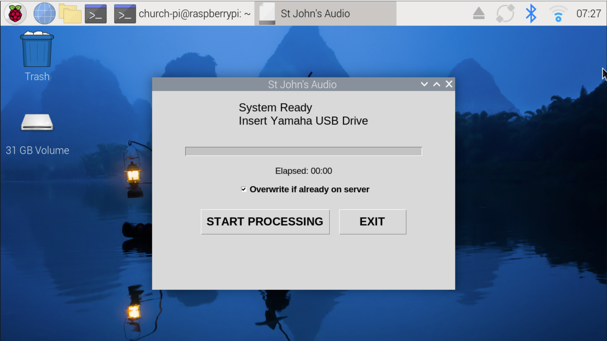

# Church Audio Pi

This script cleans up the weakly church service audio recording file using a Raspberry Pi 5.  It converts a WAV file into an MP3 and SFTP's it onto the church file server which is linked to the website.

Built for St John's Lutheran Church, American Falls, ID (https://www.stjohnsaf.com) and shared in case it helps another small church.

Plug in the USB drive from a Yamaha TF1 mixer (or other digital recording device). The Pi finds that day's WAV file, cleans it up, converts it to MP3, saves a copy to a permanent archive drive, uploads it over SFTP, and emails a report.



## How it works

```
USB drive inserted
   -> udev rule notices it
   -> systemd starts church-audio@<device>.service
   -> audio_exporter.py runs
        1. finds today's WAV (YYYYMMDD*.wav, last 6 days)
        2. checks the server; skips or overwrites if the MP3 already exists
        3. removes clicks/static (ffmpeg adeclick + afftdn)
        4. splits on silence, filters, normalizes, reassembles
        5. exports a 128k MP3 to the archive drive (Music/<FOLDER_PREFIX><year>/)
        6. uploads it by SFTP (dated file + Current_Service.mp3)
        7. deletes old WAVs from the recording drive (keeps newest 2)
        8. emails a SUCCESS / SKIPPED / FAILED report
        9. safely ejects the recording drive when finished
```

udev only hands the event to systemd and returns right away. Running a long conversion directly from a udev `RUN+=` rule blocks udev and gets killed on timeout, which is why the Pi felt sluggish in the first design.

## Hardware

- [Raspberry Pi 5](https://a.co/d/08C08Ive) (8GB RAM, 128GB Micro SD Card) with Raspberry Pi OS (desktop, auto-login enabled). Tested on Debian 12 (bookworm) with Python 3.11.2.
- Small touchscreen (optional, shows progress). This build used a [Raspberry Pi 7" Touch Display 2](https://www.canakit.com/raspberry-pi-touch-display-2.html) installed in a [SmartiPi Touch Pro 3](https://a.co/d/0h3TJfJD)
- Yamaha TF1 mixer recording WAV files to a USB drive (any FAT32/exFAT drive on hand that week)
- A second, permanently connected [USB drive](https://a.co/d/07iYT3mx) labeled `CHURCHMUSIC` for storage of finished MP3s

## Warnings

- **The script deletes files.** After a successful upload it removes every `.wav` on the recording drive except the two newest (sorted by the date in the filename). Do not point it at a drive holding recordings you care about.
- The "Overwrite if already on server" checkbox is on by default. Re-running on the same day replaces the file on the server.
- Any USB drive you plug in briefly triggers the service, except the one labeled `CHURCHMUSIC`. A drive with no matching WAV files just produces a "No service files found" email.

## Quick start

Full instructions are in [SETUP_NOTES.md](SETUP_NOTES.md). In short:

1. Install packages and create the Python virtual environment.
2. Format and label the archive drive `CHURCHMUSIC` and add it to `/etc/fstab`.
3. Copy `.env.example` to `.env` and fill in your values.
4. Install the systemd units and udev rule, and add the sudoers entry.
5. Test by hand with `sudo systemctl start church-audio@sda1.service` (use your real partition name), then try plugging a drive in.

## Configuration

All site-specific settings live in `.env` (copy `.env.example` and fill it in). Nothing about your server is written into the code.

| Setting | Required | Meaning |
|---|---|---|
| `SFTP_HOST` | yes | Server the MP3 is uploaded to |
| `SFTP_PORT` | no | Default 22 |
| `SFTP_USERNAME`, `SFTP_PASSWORD` | yes | SFTP login |
| `SFTP_REMOTE_DIR` | yes | Folder on the server that receives the files |
| `LATEST_FILENAME` | no | Copy overwritten each week. Default `Current_Service.mp3` |
| `EMAIL_USER`, `EMAIL_PASS` | yes | Gmail sender and its App Password |
| `EMAIL_TO` | yes | Comma-separated report recipients |
| `ORG_NAME` | no | Used in email subjects, window title and MP3 Album/Artist tags |
| `FOLDER_PREFIX` | no | Year folder name, `<prefix><year>`. Default `Service_` |
| `DAYS_TO_CHECK` | no | How many days back to look for a WAV. Default 6 |
| `OUTPUT_PATH` | no | Archive drive mount point. Default `/mnt/church_music` |

If a required setting is missing, the script stops immediately and prints which one in the journal.

The WAV file name pattern (`YYYYMMDD*.wav`, as the Yamaha TF1 writes it), the 128k MP3 bitrate and the "keep the newest 2 WAV files" rule are set in `audio_exporter.py`. The service and sudoers files assume the Linux user `church-pi`. If yours differs, change it in both.

## Files

| File | Purpose |
|---|---|
| `audio_exporter.py` | The main script (processing, upload, touchscreen UI) |
| `church-audio@.service` | systemd unit, one instance per inserted drive |
| `mount-church-music.service` | Remounts the archive drive if it is unplugged and replugged |
| `99-church-audio.rules` | udev rules that trigger the services |
| `.env.example` | Template for your private `.env` |
| `requirements.txt` | Python dependencies |
| `SETUP_NOTES.md` | Step-by-step installation guide |

## Troubleshooting

**Read the logs**

```bash
journalctl -u church-audio@sda1.service -n 50 --no-pager
```

Use your own partition name. Avoid `-f` unless you want a live view, and press Ctrl+C to leave it.

**Starting the service by hand fails with "wrong fs type, bad option, bad superblock"**
You used the whole-disk name (`sda`) when the filesystem is on a partition. Run `lsblk -f` and use the partition (`sda1`).

**"The unit file changed on disk"**
Run `sudo systemctl daemon-reload` after editing any `.service` file.

**"No service files found on USB"**
The drive needs a WAV file whose name starts with a date from the last 6 days (`YYYYMMDD`, as the TF1 writes it). Check the Pi's clock.

**"Output drive not found"**
Check `lsblk -f` shows the `CHURCHMUSIC` drive mounted at `/mnt/church_music`, and run `sudo mount -a`.

**"ERROR: SFTP_HOST is not set" (or another setting)**
Your `.env` is missing a required setting, or it isn't in the same folder as `audio_exporter.py`. Compare it with `.env.example`.

**No email arrives**
Gmail needs an App Password in `EMAIL_PASS`. A normal password fails.

**No window appears on the touchscreen**
The service sets `DISPLAY=:0`, so the Pi must be logged in to the desktop (auto-login).

## Security notes

- Keep `.env` out of Git and run `chmod 600 .env`.
- The sudoers rule allows passwordless `mount` and `umount` with any arguments. That is a convenience for a dedicated appliance and not something to copy onto a shared machine.
- The SFTP connection does not verify the server's host key. Verifying it, and using SSH key login instead of a password, would be safer.
- If real credentials were ever committed anywhere, rotate them. Deleting the file does not remove it from Git history.

## License

MIT. See [LICENSE](LICENSE).

For information about the church, see https://www.stjohnsaf.com.
